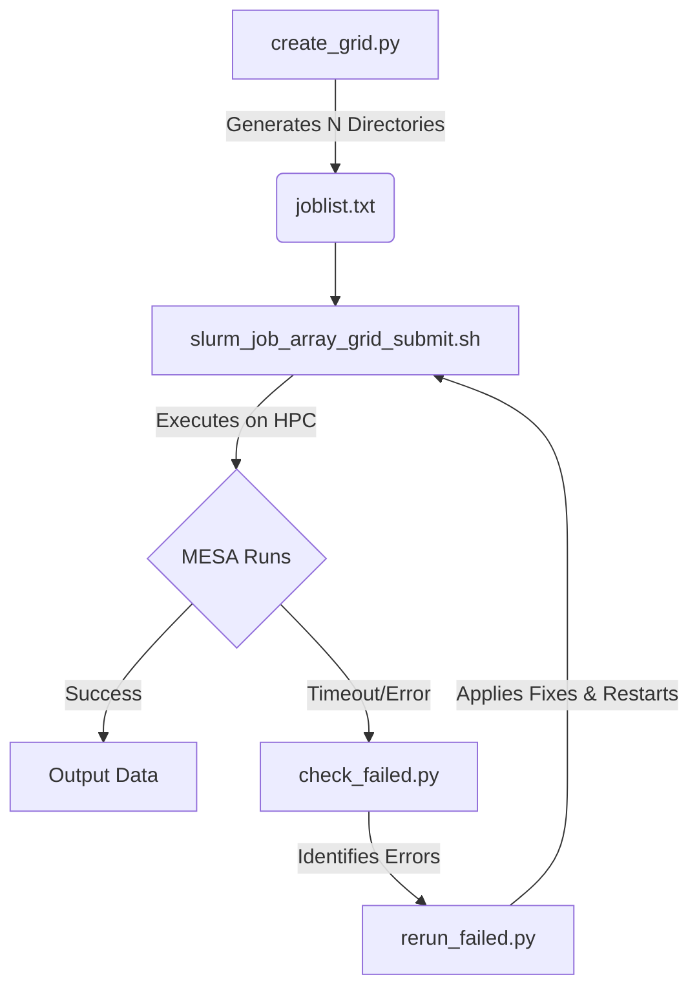

# MESA Grid Management Scripts

This repository/folder contains a suite of Python and Bash scripts designed to automate the creation, execution, and troubleshooting of MESA (Modules for Experiments in Stellar Astrophysics) model grids on a SLURM-based high-performance computing (HPC) cluster.

## Overview of Files

1. **`create_grid.py`**
   * **Purpose:** Generates the directory structure and input files for a grid of MESA runs.
   * **How it works:** It iterates through permutations of initial donor masses (`m1`), point masses (`m2`), initial periods (`Porb`), and accretion efficiencies (`beta`). It copies a clean MESA template directory for each run, injects the specific parameters into the `inlist_project` file, and generates a `joblist.txt` mapping file (ID to directory).

2. **`slurm_job_array_grid_submit.sh`**
   * **Purpose:** Submits the generated grid to a SLURM cluster using job arrays.
   * **How it works:** It reads the `joblist.txt` file generated by `create_grid.py`. Based on the `$SLURM_ARRAY_TASK_ID`, it navigates to the correct run directory, cleans previous build files, recompiles, and runs MESA, piping the output to `log.txt`.

3. **`check_failed.py`**
   * **Purpose:** Audits the completed/running grid to identify failed or timed-out runs.
   * **How it works:** Scans all run directories for `log.txt`. It extracts unique termination codes to summarize how runs ended and identifies runs that likely timed out or crashed without writing a termination code.

4. **`rerun_failed.py`**
   * **Purpose:** Prepares incomplete/timed-out runs for a retry with adjusted parameters.
   * **How it works:** Identifies runs lacking the standard termination code, duplicates the run folder (appending `_retry`), and automatically applies inlist fixes (e.g., adjusting `opacity_max` constraints) to help the model push past numerical difficulties.

## Prerequisites

* **Python 3.x:** Standard libraries only (`os`, `shutil`, `itertools`, `glob`), plus `numpy`.
* **MESA & MESASDK:** Must be installed and properly sourced in your environment/submission script.
* **SLURM Workload Manager:** Required for the bash submission script.

## Workflow & Usage

### 1. Prepare your Grid
Open `create_grid.py` and modify the parameter arrays (`m1_vals`, `m2_vals`, `porb_vals`, `beta_ctrl`) to define your grid bounds. Set your `template_dir` (a clean MESA run folder) and `runs_dir` (where the grid will be generated).
```bash
python3 create_grid.py
```
*This will create your run directories and output a `joblist.txt`.*

### 2. Submit to the Cluster
Edit `slurm_job_array_grid_submit.sh` to add your specific SLURM account details, email, MESASDK/MESA paths, and the base `PATH` to your run directories. Set the `#SBATCH --array=` directive to match the number of jobs generated in `joblist.txt` (e.g., `--array=1-100`).
```bash
sbatch slurm_job_array_grid_submit.sh
```

### 3. Monitor and Check Status
Once the jobs have finished (or to check on progress), run the checking script. Make sure `runs_dir` in the script points to your grid.
```bash
python3 check_failed.py
```
*This will print a summary of unique termination reasons and a list of runs that timed out or failed silently.*

### 4. Fix and Rerun Failures
To automatically prepare retries for timed-out runs, use the rerun script. Ensure `runs_dir` is correctly set. You can customize the `apply_fix()` function in the Python script to apply specific MESA inlist tweaks (like changing opacities, mesh resolution, or timestep limits) for stubborn models.
```bash
python3 rerun_failed.py
```
*This outputs a `timeout_runs.txt` summary and generates `*_retry` folders ready for a new job submission.*

### Architecture Flow



## Customization Notes
* **Termination Codes:** By default, the checking scripts look for "termination code" in `log.txt`. If your MESA setup outputs a different success string, update the `keywords` and `expected_end` variables in `check_failed.py` and `rerun_failed.py`.
* **Fixes:** The `rerun_failed.py` script currently includes a placeholder fix (`reduce_opacity_max`). You should expand the `apply_fix` function to match the standard troubleshooting steps for your specific stellar models.

### Research Impact & Publications

The automation and orchestration tools in this repository were developed to manage the high-throughput MESA stellar evolution grids required for large-scale astrophysical population synthesis. 

These scripts directly facilitated the modeling, simulation scaling, and analysis published in the following peer-reviewed *Astronomy & Astrophysics* (A&A) papers:

* **Misra, D.**, Koljonen, K. I. I., & Linares, M. (2025). *"The slowest spinning Galactic-field spider PSRJ1932+2121: A history of inefficient mass transfer."* Monthly Notices of the Royal Astronomical Society, 541, L58.
*   **Misra, D.**, Linares, M., & Ye, C. S. (2025). *"Investigating cannibalistic millisecond pulsar binaries using MESA: New constraints from pulsar spin and mass evolution."* Astronomy & Astrophysics, 693, A314.
    *   [Read on NASA ADS](https://ui.adsabs.harvard.edu/abs/2025A%26A...693A.314M/abstract)
*   **Misra, D.**, Fragos, T., Tauris, T. M., Zapartas, E., & Aguilera-Dena, D. R. (2020). *"The origin of pulsating ultra-luminous X-ray sources: Low- and intermediate-mass X-ray binaries containing neutron star accretors."* Astronomy & Astrophysics, 642, A174.
    *   [Read on NASA ADS](https://ui.adsabs.harvard.edu/abs/2020A%26A...642A.174M/abstract)

### Scientific Use Case 
In computational astrophysics, evaluating theoretical boundaries against observational data requires iterating over massive, multi-dimensional parameter spaces. By automating parameter grid generation (`create_grid.py`), executing parallel HPC arrays via SLURM (`slurm_job_array_grid_submit.sh`), and implementing fault-tolerant log scraping for timed-out or failed runs (`check_failed.py`, `rerun_failed.py`), this pipeline provided the necessary infrastructure to scale these simulations. This systematic approach ensured reproducible, robust generation of the evolutionary tracks and population statistics presented in the research above.
